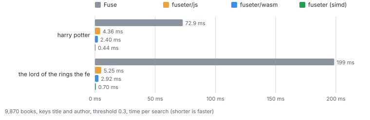
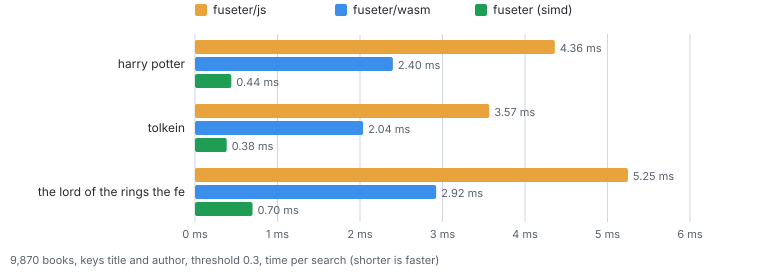

**"Fuseter" = Fuse + Faster**

Fuseter is a replacement for [Fuse.js](https://github.com/krisk/fuse) that is significantly faster and comes with some heuristics for improved scoring. Full parity is a WIP.

Fuseter is 10-40x faster with the plain js tier and 100-300x faster with the simd tier.

ESM only; `require()` works on Node 20.19+ and 22.12+.

Usage:

```js
import { Fuseter } from "fuseter";          // or "fuseter/js", "fuseter/wasm", "fuseter/simd"
const ff = await Fuseter.create(books, { keys: [{ name: "title", weight: 3 }, "author"], threshold: 0.3, includeScore: true });
ff.search("hary poter", { limit: 10 });        // [{ item, refIndex, score }]
ff.backend;                                    // the tier that is really running
```

## Backends

Fuseter has three implementations of the same search.



The same measurements without Fuse, using a linear scale to better see differences between the three variants.



| tier | needs | download (gzip) | search, 10K docs, threshold 0.3 |
|---|---|---|---|
| `simd` | WebAssembly SIMD (all current browsers and Node) | 25 KB | 0.4-0.7 ms |
| `wasm` | WebAssembly | 12.7 KB | 2-3 ms |
| `js` | nothing | 8.7 KB | 4-5 ms |
| Fuse 7.5 | nothing | | 40-200 ms |

What to choose:

- **Default**: `import { Fuseter } from "fuseter"` uses simd and falls back to the js build automatically if needed (no WebAssembly, blocked by a Content-Security-Policy, out of memory).
- **Smallest bundle**: import from `fuseter/js` or `fuseter/wasm`. `fuseter/js` contains no wasm at all, and `fuseter/wasm` only the small scalar module.
- **A specific tier**: `Fuseter.create(docs, options, { backend: "wasm" })`. `fallback` sets how far it may degrade: `"js"` (default), `"wasm"`, or `"throw"` to fail instead.
- **Without await**: `Fuseter.createSync(docs, options)` returns a js instance immediately, because wasm compiles asynchronously.

To see what you end up with, check `ff.backend` and `ff.fallbackReason`.

## Differences from Fuse

**Will be fixed in later versions:**
- `ignoreLocation` is always on (and is the default here). `location` and `distance` are accepted and ignored.
- Not supported, rejected with a `TypeError`: `useExtendedSearch`, `useTokenSearch`, `includeMatches`, `findAllMatches`, `minMatchCharLength > 1`, `shouldSort: false`, `sortFn`, `getFn` (also per key), unknown options, non-string queries.

**Supported:** string collections, `keys` (names, dotted paths, path arrays, weights), array values (each element is a separate string like in Fuse, at most 64 strings per document), numbers and booleans as text, `threshold` (also per search), `limit`, `includeScore`, `isCaseSensitive`, `ignoreDiacritics`, `ignoreFieldNorm`, `fieldNormWeight`, blank queries (return every document, like Fuse), patterns longer than 32 characters (chunked like Fuse, slower: no in-wasm combine).

**Deliberate differences:**
- `ignoreDiacritics` strips `\p{M}`, Fuse uses a fixed list of marks; 73 recently added code points differ.
- Objects inside array values are ignored (Fuse indexes `"[object Object]"`).

## Typing heuristics (experimental)

A couple of heuristics to better match how people type and make typos.

They change the ranking, so results no longer match Fuse, and the options are not stable yet. Without `typing`, results are identical to Fuse.

```js
Fuseter.create(models, { keys: ["name"], typing: { firstLetter: true, transposition: true } });
```

- `firstLetter`: the first letter of each query word counts double. A wrong or missing first letter costs 2 errors. This is based on research suggesting that the first letter is rarely wrong ([Pollock & Zamora, 1983](https://doi.org/10.1002/asi.4630340108); [abbreviation expansion for users with motor disabilities](https://www.researchgate.net/publication/336536172_A_Probabilistic_Flexible_Abbreviation_Expansion_System_for_Users_With_Motor_Disabilities)).
  - `{ weighted: "first" }` weights only the first letter of the whole query instead of every word.
  - `{ midWord: 2 }` makes a correct first letter in the middle of a word cost as much as a wrong one (default 1).
  - Words start after spaces and punctuation, and at camelCase humps (`myValue`). Queries over 32 characters ignore the option.
- `transposition`: swapping two adjacent letters costs 1 error instead of 2.

Cost on 10K books: `transposition` makes searches 20-25% slower, `firstLetter` roughly 2x slower (simd: 0.3 ms becomes 0.5 ms; see `scripts/bench-typing.mjs`). On the simd tier each option set loads an extra 9-12 KB (gzip) wasm module the first time it is used.

## Development

- `npm install`, then `npm test`: runs the equivalence suite (random corpora, all tiers, thresholds 0-1, limits, every supported option, forced fallbacks) against the Fuse 7.5 dev dependency. Takes about a minute.
- `npm run build:wasm` rebuilds `wasm/*.wasm` and the embedded `src/wasm/*.mjs` from `zig/` (needs zig 0.17; the generated `src/wasm/*.mjs` are committed and CI fails if a rebuild changes them).
- `node scripts/browser-check.mjs [chromium] [firefox] [webkit]` bundles the library with esbuild (code splitting) and runs the Fuse comparison, the typing options and the fallback logic in real browsers, once normally and once under a CSP that blocks wasm. Setup: `npm i --no-save playwright esbuild && npx playwright install chromium firefox`. Last run: Chromium 156 and Firefox 157 pass; Safari is untested.
- `node scripts/bench.mjs [books.json] [--fuse] [--json=file]` prints a timing table (`--json` saves it, `node scripts/chart.mjs` turns it into the charts in `docs/`); `node scripts/bench-typing.mjs [books.json]` compares the typing heuristics with the standard kernels.
