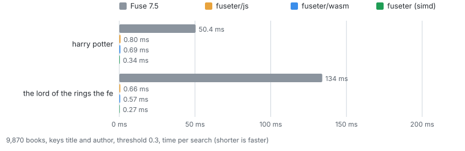
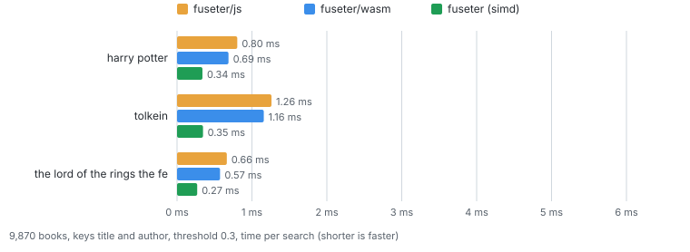

**"Fuseter" = Fuse + Faster**

Fuseter is a replacement for [Fuse.js](https://github.com/krisk/fuse) that is significantly faster and comes with some heuristics for improved scoring. Full parity is a WIP.

- 25-200x faster than Fuse 7.5 (plain js tier)
- 100-500x faster (simd tier)
- Same results and scores as Fuse, unless you turn on the [typing heuristics](docs/typing.md)

Fuse has released a 7.6 beta, which is about 10x faster than 7.5. All comparisons with Fuse in this README are against Fuse 7.5 and earlier.

ESM only; `require()` works on Node 20.19+ and 22.12+.

## Usage

```js
import { Fuseter } from "fuseter";          // or "fuseter/js", "fuseter/wasm", "fuseter/simd"
const ff = await Fuseter.create(books, { keys: [{ name: "title", weight: 3 }, "author"], threshold: 0.3, includeScore: true });
ff.search("hary poter", { limit: 10 });        // [{ item, refIndex, score }]
ff.backend;                                    // the tier that is running
```

The options, methods and return values follow Fuse's. See [Options and API](docs/options.md).

## Backends

Fuseter has three implementations of the same search.



The same measurements without Fuse, using a linear scale to better see differences between the three variants.



| tier | needs | download (gzip) | search, 10K docs, threshold 0.3 |
|---|---|---|---|
| `simd` | WebAssembly SIMD (all current browsers and Node) | 31.4 KB | 0.3-0.4 ms |
| `wasm` | WebAssembly | 22.1 KB | 0.6-1.2 ms |
| `js` | nothing | 17.6 KB | 0.7-1.3 ms |
| Fuse 7.5 | nothing | | 33-134 ms |
| Fuse 7.6 beta | nothing | | 4-5 ms |

Download sizes are the entry point minified with esbuild and gzipped.

What to choose:

- **Default**: `import { Fuseter } from "fuseter"` uses simd and falls back to js if needed.
- **Smallest bundle**: import from `fuseter/js`, no wasm.
- **A specific tier**: `Fuseter.create(docs, options, { backend: "wasm" })`. `fallback` sets how far it may degrade: `"js"` (default), `"wasm"`, or `"throw"` to fail instead.
- **Without await**: `Fuseter.createSync(docs, options)` returns a js instance immediately, because wasm compiles asynchronously.

To see what you end up with, check `ff.backend` and `ff.fallbackReason`.

## Differences from Fuse

Everything else in Fuse's API is supported, see [Options and API](docs/options.md).

**Deliberate differences:**
- `ignoreLocation` defaults to `true` (Fuse: `false`), because [location scoring](docs/location.md) is slower. Pass `ignoreLocation: false` for Fuse's default behaviour.
- `ignoreDiacritics` strips `\p{M}`, Fuse uses a fixed list of marks; 73 recently added code points differ.
- Objects inside array values are ignored (Fuse indexes `"[object Object]"`).

**Will be fixed in later versions:**
- Unknown options are rejected with a `TypeError`.

## Documentation

- [Options and API](docs/options.md): supported options, changing the collection, indexes
- [Location scoring](docs/location.md): Fuse's default `ignoreLocation: false` behaviour
- [Extended search](docs/extended-search.md): `^`, `$`, `'`, `!`, `=` and `|` query syntax
- [Token search](docs/token-search.md): search the words of a query separately
- [Logical queries](docs/logical-queries.md): `$and` / `$or` queries
- [Match, parseQuery and plugins](docs/plugins.md): `Fuseter.match`, `Fuseter.parseQuery`, `Fuseter.use`
- [Match highlighting](docs/highlighting.md): `includeMatches` and experimental highlighting
- [Typing heuristics](docs/typing.md) (experimental): first-letter weighting and transposition

## Development

- `npm install`, then `npm test`: runs the equivalence suite (random corpora, all tiers, thresholds 0-1, limits, every supported option, forced fallbacks) against the Fuse 7.5 dev dependency. Takes about a minute.
- `npm run build:wasm` rebuilds `wasm/*.wasm` and the embedded `src/wasm/*.mjs` from `zig/` (needs zig 0.17). The generated `src/wasm/*.mjs` are committed, and CI fails if a rebuild changes them.
- `node scripts/browser-check.mjs [chromium] [firefox] [webkit]` bundles the library with esbuild (code splitting) and runs the Fuse comparison, the typing options and the fallback logic in real browsers, once normally and once under a CSP that blocks wasm. Setup: `npm i --no-save playwright esbuild && npx playwright install chromium firefox`. Last run: Chromium 156 and Firefox 157 pass; Safari is untested.
- Benchmarks (`FUSE=0` skips Fuse in the typing, tokens and location ones):
  - `node scripts/bench.mjs [books.json] [--fuse] [--json=file]` prints a timing table. `--json` saves it, and `node scripts/chart.mjs` turns it into the charts in `docs/`.
  - `node scripts/bench-typing.mjs [books.json]` compares the typing heuristics with the standard kernels.
  - `node scripts/bench-tokens.mjs [books.json]` compares token search with plain search and Fuse's token search.
  - `node scripts/bench-location.mjs [books.json]` compares `ignoreLocation: false` with `true`.
  - `node scripts/bench-extended.mjs [books.json]` times extended search queries.
